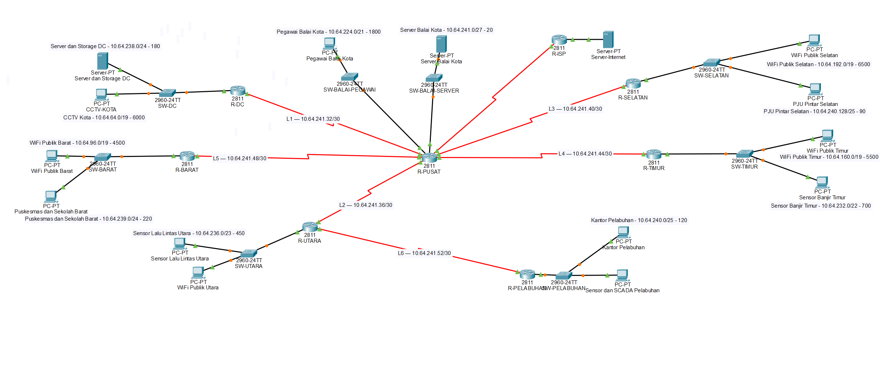

# Dokumentasi Perancangan Jaringan Smart City Kota Surabaya

## 1. Gambar Topologi Jaringan

Topologi dirancang untuk menghubungkan jaringan Balai Kota, pusat data, lima router wilayah, jaringan Pelabuhan, dan ISP melalui koneksi WAN.

## 2. Alasan Pemilihan Skema VLSM

Pada perancangan jaringan Smart City Kota Surabaya, skema **Variable Length Subnet Mask (VLSM)** dipilih sebagai metode alokasi subnet berdasarkan kebutuhan host setiap LAN.

Pertimbangan pemilihan VLSM adalah sebagai berikut:

1. **Kebutuhan host berbeda-beda.** Jaringan WiFi publik, CCTV, server, sensor, dan perangkat lainnya membutuhkan jumlah alamat IP yang berbeda.
2. **Penggunaan alamat IP lebih efisien.** Setiap jaringan dapat menggunakan prefix yang sesuai dengan jumlah host yang dibutuhkan, sehingga tidak semua LAN harus menggunakan ukuran subnet yang sama.
3. **Pengalamatan lebih terstruktur.** Setiap LAN dan link antar-router memiliki Network ID, prefix, rentang alamat host, broadcast address, dan gateway yang terdokumentasi.
4. **Sesuai dengan hasil perhitungan UTS.** Alokasi subnet menggunakan hasil perhitungan subnetting yang telah dibuat dan disesuaikan dengan kebutuhan host setiap jaringan.

CIDR juga mendukung prefix dengan panjang yang bervariasi dan agregasi rute. Namun, VLSM dipilih karena pendekatan alokasinya sesuai dengan kebutuhan host yang berbeda pada masing-masing LAN dalam proyek ini.

## 3. Penjelasan Desain Topologi

Alokasi alamat IP dilakukan menggunakan metode VLSM untuk
menyesuaikan kebutuhan host setiap jaringan.

Detail pembagian subnet dapat dilihat pada [Tabel Alokasi VLSM](https://docs.google.com/spreadsheets/d/12Tc-e2IoO7rye4RuHGMcsNEBEp5KzE1eh5NwAQSng9w/edit?usp=sharing).

### 3.1. Router Pusat (R-PUSAT)

R-PUSAT berfungsi sebagai pusat konektivitas jaringan Smart City. Router ini menghubungkan jaringan Balai Kota, R-DC, R-UTARA, R-BARAT, R-TIMUR, dan R-SELATAN melalui link WAN. R-PUSAT juga terhubung dengan R-ISP untuk akses internet serta menjadi endpoint tunnel GRE menuju R-PELABUHAN.

| Koneksi/LAN | Network ID | Prefix | Subnet Mask | IP R-PUSAT / Gateway |
|---|---|---|---|---|
| Pegawai Balai Kota | `10.64.224.0` | `/21` | `255.255.248.0` | `10.64.224.1` |
| Server Balai Kota | `10.64.241.0` | `/27` | `255.255.255.224` | `10.64.241.1` |
| Link ISP | `203.0.113.32` | `/30` | `255.255.255.252` | `203.0.113.33` |

LAN Pegawai Balai Kota menggunakan prefix `/21`, sedangkan LAN Server Balai Kota menggunakan `/27` karena kebutuhan host keduanya berbeda.

### 3.2. Jaringan Pusat Data (R-DC)

R-DC menghubungkan jaringan CCTV Kota dan Server dan Storage DC. Kedua LAN dipisahkan menggunakan VLAN 10 dan VLAN 20 pada switch. Router-on-a-stick digunakan untuk menyediakan gateway melalui subinterface dengan enkapsulasi 802.1Q.

| LAN | Network ID | Prefix | Subnet Mask | Gateway | Contoh IP Perangkat |
|---|---|---|---|---|---|
| CCTV Kota | `10.64.64.0` | `/19` | `255.255.224.0` | `10.64.64.1` | `10.64.64.2` |
| Server dan Storage DC | `10.64.238.0` | `/24` | `255.255.255.0` | `10.64.238.1` | `10.64.238.2` |

Alamat gateway CCTV berada pada subinterface `FastEthernet0/0.10`, sedangkan gateway Server dan Storage DC berada pada `FastEthernet0/0.20`.

### 3.3. Jaringan Wilayah Utara (R-UTARA)

R-UTARA melayani WiFi Publik Utara dan Sensor Lalu Lintas Utara. Kedua LAN menggunakan VLAN berbeda agar jaringan pengguna dan sensor dapat dikelola secara terpisah.

| LAN | Network ID | Prefix | Subnet Mask | Gateway | Contoh IP Perangkat |
|---|---|---|---|---|---|
| WiFi Publik Utara | `10.64.0.0` | `/18` | `255.255.192.0` | `10.64.0.1` | `10.64.0.2` |
| Sensor Lalu Lintas Utara | `10.64.236.0` | `/23` | `255.255.254.0` | `10.64.236.1` | `10.64.236.2` |

Selain melayani kedua LAN tersebut, R-UTARA terhubung ke R-PUSAT melalui L2 dan ke R-PELABUHAN melalui L6.

### 3.4. Jaringan Wilayah Barat (R-BARAT)

R-BARAT menghubungkan jaringan WiFi Publik Barat dengan jaringan Puskesmas dan Sekolah Barat.

| LAN | Network ID | Prefix | Subnet Mask | Gateway | Contoh IP Perangkat |
|---|---|---|---|---|---|
| WiFi Publik Barat | `10.64.96.0` | `/19` | `255.255.224.0` | `10.64.96.1` | `10.64.96.2` |
| Puskesmas dan Sekolah Barat | `10.64.239.0` | `/24` | `255.255.255.0` | `10.64.239.1` | `10.64.239.2` |

Pemisahan kedua LAN memungkinkan jaringan WiFi publik dan jaringan layanan kesehatan serta pendidikan memiliki ruang alamat masing-masing.

### 3.5. Jaringan Wilayah Timur (R-TIMUR)

R-TIMUR melayani WiFi Publik Timur dan Sensor Banjir Timur.

| LAN | Network ID | Prefix | Subnet Mask | Gateway | Contoh IP Perangkat |
|---|---|---|---|---|---|
| WiFi Publik Timur | `10.64.160.0` | `/19` | `255.255.224.0` | `10.64.160.1` | `10.64.160.2` |
| Sensor Banjir Timur | `10.64.232.0` | `/22` | `255.255.252.0` | `10.64.232.1` | `10.64.232.2` |

WiFi publik dan sensor banjir ditempatkan pada subnet yang berbeda untuk memisahkan pengalamatan kedua jenis layanan tersebut.

### 3.6. Jaringan Wilayah Selatan (R-SELATAN)

R-SELATAN menghubungkan jaringan WiFi Publik Selatan dan PJU Pintar Selatan.

| LAN | Network ID | Prefix | Subnet Mask | Gateway | Contoh IP Perangkat |
|---|---|---|---|---|---|
| WiFi Publik Selatan | `10.64.192.0` | `/19` | `255.255.224.0` | `10.64.192.1` | `10.64.192.2` |
| PJU Pintar Selatan | `10.64.240.128` | `/25` | `255.255.255.128` | `10.64.240.129` | `10.64.240.130` |

Kedua LAN menggunakan subnet berbeda sesuai kebutuhan host masing-masing.

### 3.7. Jaringan Pelabuhan (R-PELABUHAN)

R-PELABUHAN melayani jaringan Sensor dan SCADA Pelabuhan serta Kantor Pelabuhan. Router ini terhubung ke R-UTARA melalui L6 dan direncanakan memiliki tunnel GRE dengan R-PUSAT.

| LAN | Network ID | Prefix | Subnet Mask | Gateway | Contoh IP Perangkat |
|---|---|---|---|---|---|
| Sensor dan SCADA Pelabuhan | `10.64.128.0` | `/19` | `255.255.224.0` | `10.64.128.1` | `10.64.128.2` |
| Kantor Pelabuhan | `10.64.240.0` | `/25` | `255.255.255.128` | `10.64.240.1` | `10.64.240.2` |

Kedua jaringan dipisahkan menggunakan VLAN yang berbeda pada switch Pelabuhan. Pemisahan ini membantu pengelolaan jaringan perangkat sensor dan jaringan kantor.

### 3.8. Koneksi WAN Antar-Router

Koneksi WAN menghubungkan router pusat dengan router wilayah serta menghubungkan R-UTARA dengan R-PELABUHAN. Setiap link point-to-point menggunakan subnet `/30`, yang menyediakan dua alamat host yang dapat digunakan.

| Link | Koneksi | Network ID | Prefix | Subnet Mask | IP Endpoint |
|---|---|---|---|---|---|
| L1 | R-PUSAT – R-DC | `10.64.241.32` | `/30` | `255.255.255.252` | PUSAT `.33`, DC `.34` |
| L2 | R-PUSAT – R-UTARA | `10.64.241.36` | `/30` | `255.255.255.252` | PUSAT `.37`, UTARA `.38` |
| L3 | R-PUSAT – R-SELATAN | `10.64.241.40` | `/30` | `255.255.255.252` | PUSAT `.41`, SELATAN `.42` |
| L4 | R-PUSAT – R-TIMUR | `10.64.241.44` | `/30` | `255.255.255.252` | PUSAT `.45`, TIMUR `.46` |
| L5 | R-PUSAT – R-BARAT | `10.64.241.48` | `/30` | `255.255.255.252` | PUSAT `.49`, BARAT `.50` |
| L6 | R-UTARA – R-PELABUHAN | `10.64.241.52` | `/30` | `255.255.255.252` | UTARA `.53`, PELABUHAN `.54` |

Keenam link menggunakan alokasi WAN internal pada blok `10.64.241.32/27`. Blok tersebut mencakup alamat `10.64.241.32–10.64.241.63`; enam subnet `/30` digunakan untuk link L1–L6.

### 3.9. Koneksi ISP dan Server Internet

R-PUSAT terhubung ke R-ISP menggunakan jaringan `203.0.113.32/30`. R-ISP kemudian terhubung ke jaringan server internet `8.8.8.0/24`.

| Segmen | Network ID | Prefix | Subnet Mask | IP Perangkat |
|---|---|---|---|---|
| Link R-PUSAT – R-ISP | `203.0.113.32` | `/30` | `255.255.255.252` | PUSAT `203.0.113.33`, ISP `203.0.113.34` |
| Server Internet | `8.8.8.0` | `/24` | `255.255.255.0` | Server `8.8.8.8`, gateway `8.8.8.1` |

Link ISP menggunakan blok yang terpisah dari jaringan internal `10.64.0.0/16`. Dengan konfigurasi routing dan NAT yang sesuai, jaringan internal dapat mengakses server internet melalui R-ISP.

### 3.10. Tunnel GRE

Tunnel GRE dirancang untuk menghubungkan R-PUSAT dan R-PELABUHAN menggunakan jaringan tunnel `192.168.8.0/30`, sesuai nomor kelompok 8.

| Parameter | R-PUSAT | R-PELABUHAN |
|---|---|---|
| IP tunnel | `192.168.8.1` | `192.168.8.2` |
| Prefix | `/30` | `/30` |
| Subnet Mask | `255.255.255.252` | `255.255.255.252` |

Tunnel GRE membentuk jalur logis antara kedua router melalui jaringan underlay yang sudah tersedia. Routing harus dikonfigurasi agar lalu lintas antara subnet Balai Kota dan Pelabuhan melewati tunnel sesuai ketentuan proyek.

GRE tidak menyediakan enkripsi secara bawaan. Jika diperlukan, enkripsi dapat ditambahkan menggunakan IPsec.

## 4. Kesimpulan

Desain jaringan Smart City Kota Surabaya menggunakan R-PUSAT sebagai pusat konektivitas, router terpisah untuk setiap wilayah, VLAN untuk memisahkan LAN, serta VLSM untuk mengalokasikan alamat IP sesuai kebutuhan host.

Jaringan dilengkapi enam link WAN internal, koneksi ISP, jaringan server internet, dan rancangan tunnel GRE menuju Pelabuhan. Setiap LAN dan link memiliki Network ID, prefix, subnet mask, serta alamat gateway yang terdokumentasi untuk memudahkan konfigurasi dan pengelolaan jaringan.