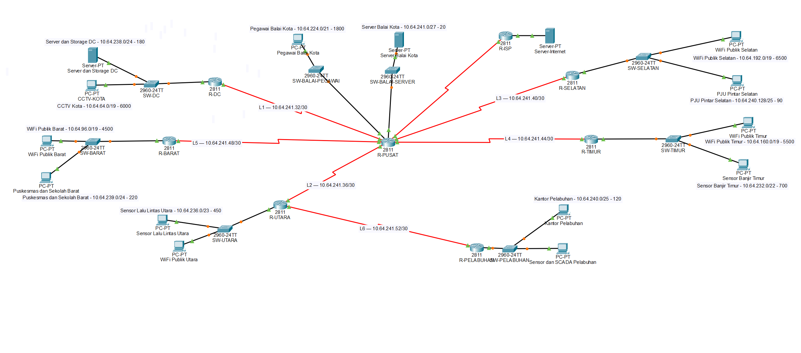
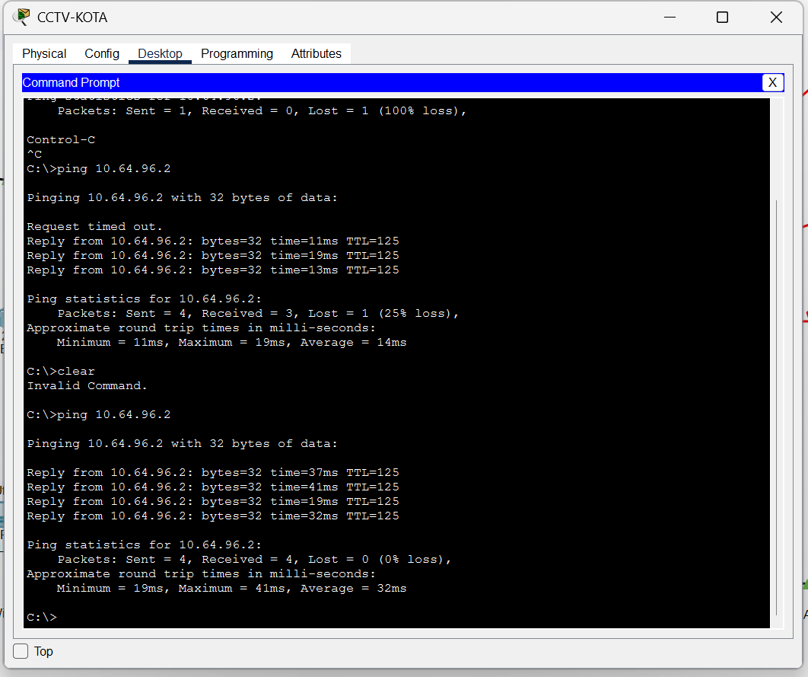
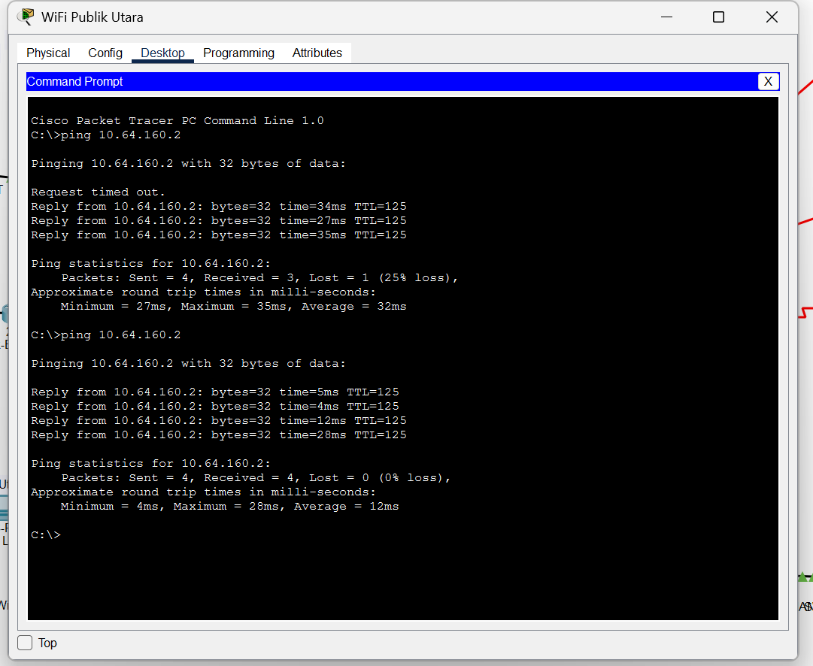
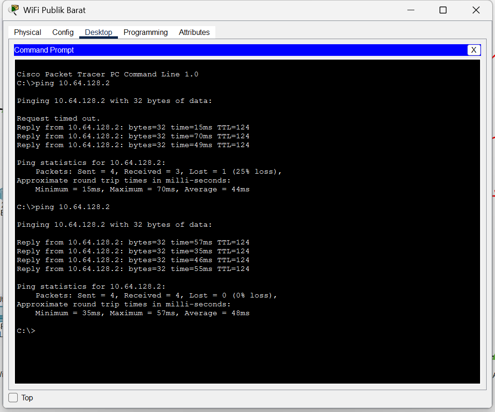
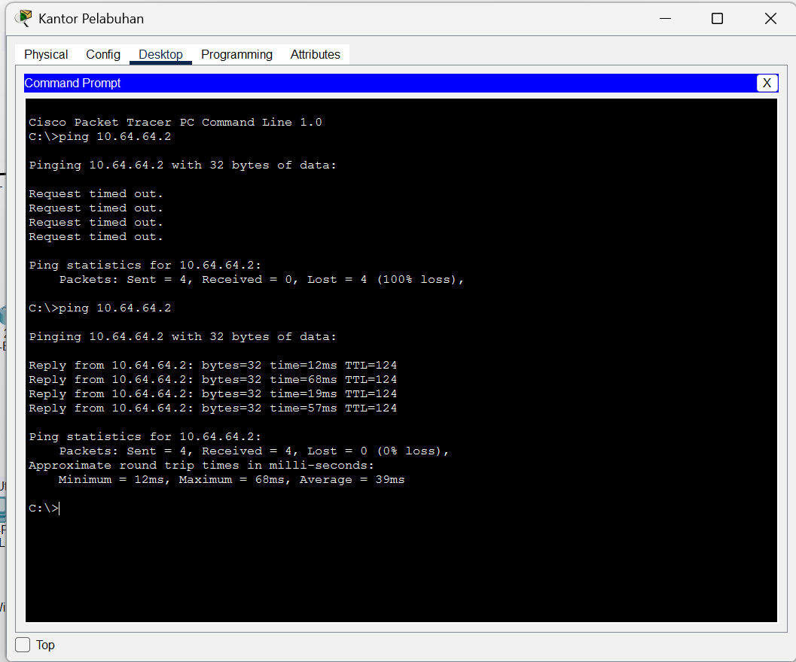

# Dokumentasi Perancangan Jaringan Smart City Kota Surabaya

## 1. Gambar Topologi Jaringan



Topologi dirancang untuk menghubungkan jaringan Balai Kota, pusat data, lima router wilayah, jaringan Pelabuhan, dan ISP melalui koneksi WAN.

## 2. Alasan Pemilihan Skema VLSM

Pada perancangan jaringan Smart City Kota Surabaya, skema **Variable Length Subnet Mask (VLSM)** dipilih sebagai metode alokasi subnet berdasarkan kebutuhan host setiap LAN.

Pertimbangan pemilihan VLSM adalah sebagai berikut:

1. **Kebutuhan host berbeda-beda.** Jaringan WiFi publik, CCTV, server, sensor, dan perangkat lainnya membutuhkan jumlah alamat IP yang berbeda.
2. **Penggunaan alamat IP lebih efisien.** Setiap jaringan dapat menggunakan prefix yang sesuai dengan jumlah host yang dibutuhkan, sehingga tidak semua LAN harus menggunakan ukuran subnet yang sama.
3. **Pengalamatan lebih terstruktur.** Setiap LAN dan link antar-router memiliki Network ID, prefix, rentang alamat host, broadcast address, dan gateway yang terdokumentasi.
4. **Sesuai dengan hasil perhitungan UTS.** Alokasi subnet menggunakan hasil perhitungan subnetting yang telah dibuat dan disesuaikan dengan kebutuhan host setiap jaringan.

CIDR juga mendukung prefix dengan panjang yang bervariasi dan agregasi rute. Namun, VLSM dipilih karena pendekatan alokasinya sesuai dengan kebutuhan host yang berbeda pada masing-masing LAN dalam proyek ini.

## 3. Penjelasan Desain Topologi


Alokasi alamat IP dilakukan menggunakan metode VLSM untuk
menyesuaikan kebutuhan host setiap jaringan.

Detail pembagian subnet dapat dilihat pada [Tabel Alokasi VLSM](https://docs.google.com/spreadsheets/d/12Tc-e2IoO7rye4RuHGMcsNEBEp5KzE1eh5NwAQSng9w/edit?usp=sharing).

### 3.1. Router Pusat (R-PUSAT)

R-PUSAT berfungsi sebagai pusat konektivitas jaringan Smart City. Router ini menghubungkan jaringan Balai Kota, R-DC, R-UTARA, R-BARAT, R-TIMUR, dan R-SELATAN melalui link WAN. R-PUSAT juga terhubung dengan R-ISP untuk akses internet serta menjadi endpoint tunnel GRE menuju R-PELABUHAN.

| Koneksi/LAN | Network ID | Prefix | Subnet Mask | IP R-PUSAT / Gateway |
|---|---|---|---|---|
| Pegawai Balai Kota | `10.64.224.0` | `/21` | `255.255.248.0` | `10.64.224.1` |
| Server Balai Kota | `10.64.241.0` | `/27` | `255.255.255.224` | `10.64.241.1` |
| Link ISP | `203.0.113.32` | `/30` | `255.255.255.252` | `203.0.113.33` |

LAN Pegawai Balai Kota menggunakan prefix `/21`, sedangkan LAN Server Balai Kota menggunakan `/27` karena kebutuhan host keduanya berbeda.

### 3.2. Jaringan Pusat Data (R-DC)

R-DC menghubungkan jaringan CCTV Kota dan Server dan Storage DC. Kedua LAN dipisahkan menggunakan VLAN 10 dan VLAN 20 pada switch. Router-on-a-stick digunakan untuk menyediakan gateway melalui subinterface dengan enkapsulasi 802.1Q.

| LAN | Network ID | Prefix | Subnet Mask | Gateway | Contoh IP Perangkat |
|---|---|---|---|---|---|
| CCTV Kota | `10.64.64.0` | `/19` | `255.255.224.0` | `10.64.64.1` | `10.64.64.2` |
| Server dan Storage DC | `10.64.238.0` | `/24` | `255.255.255.0` | `10.64.238.1` | `10.64.238.2` |

Alamat gateway CCTV berada pada subinterface `FastEthernet0/0.10`, sedangkan gateway Server dan Storage DC berada pada `FastEthernet0/0.20`.

### 3.3. Jaringan Wilayah Utara (R-UTARA)

R-UTARA melayani WiFi Publik Utara dan Sensor Lalu Lintas Utara. Kedua LAN menggunakan VLAN berbeda agar jaringan pengguna dan sensor dapat dikelola secara terpisah.

| LAN | Network ID | Prefix | Subnet Mask | Gateway | Contoh IP Perangkat |
|---|---|---|---|---|---|
| WiFi Publik Utara | `10.64.0.0` | `/18` | `255.255.192.0` | `10.64.0.1` | `10.64.0.2` |
| Sensor Lalu Lintas Utara | `10.64.236.0` | `/23` | `255.255.254.0` | `10.64.236.1` | `10.64.236.2` |

Selain melayani kedua LAN tersebut, R-UTARA terhubung ke R-PUSAT melalui L2 dan ke R-PELABUHAN melalui L6.

### 3.4. Jaringan Wilayah Barat (R-BARAT)

R-BARAT menghubungkan jaringan WiFi Publik Barat dengan jaringan Puskesmas dan Sekolah Barat.

| LAN | Network ID | Prefix | Subnet Mask | Gateway | Contoh IP Perangkat |
|---|---|---|---|---|---|
| WiFi Publik Barat | `10.64.96.0` | `/19` | `255.255.224.0` | `10.64.96.1` | `10.64.96.2` |
| Puskesmas dan Sekolah Barat | `10.64.239.0` | `/24` | `255.255.255.0` | `10.64.239.1` | `10.64.239.2` |

Pemisahan kedua LAN memungkinkan jaringan WiFi publik dan jaringan layanan kesehatan serta pendidikan memiliki ruang alamat masing-masing.

### 3.5. Jaringan Wilayah Timur (R-TIMUR)

R-TIMUR melayani WiFi Publik Timur dan Sensor Banjir Timur.

| LAN | Network ID | Prefix | Subnet Mask | Gateway | Contoh IP Perangkat |
|---|---|---|---|---|---|
| WiFi Publik Timur | `10.64.160.0` | `/19` | `255.255.224.0` | `10.64.160.1` | `10.64.160.2` |
| Sensor Banjir Timur | `10.64.232.0` | `/22` | `255.255.252.0` | `10.64.232.1` | `10.64.232.2` |

WiFi publik dan sensor banjir ditempatkan pada subnet yang berbeda untuk memisahkan pengalamatan kedua jenis layanan tersebut.

### 3.6. Jaringan Wilayah Selatan (R-SELATAN)

R-SELATAN menghubungkan jaringan WiFi Publik Selatan dan PJU Pintar Selatan.

| LAN | Network ID | Prefix | Subnet Mask | Gateway | Contoh IP Perangkat |
|---|---|---|---|---|---|
| WiFi Publik Selatan | `10.64.192.0` | `/19` | `255.255.224.0` | `10.64.192.1` | `10.64.192.2` |
| PJU Pintar Selatan | `10.64.240.128` | `/25` | `255.255.255.128` | `10.64.240.129` | `10.64.240.130` |

Kedua LAN menggunakan subnet berbeda sesuai kebutuhan host masing-masing.

### 3.7. Jaringan Pelabuhan (R-PELABUHAN)

R-PELABUHAN melayani jaringan Sensor dan SCADA Pelabuhan serta Kantor Pelabuhan. Router ini terhubung ke R-UTARA melalui L6 dan direncanakan memiliki tunnel GRE dengan R-PUSAT.

| LAN | Network ID | Prefix | Subnet Mask | Gateway | Contoh IP Perangkat |
|---|---|---|---|---|---|
| Sensor dan SCADA Pelabuhan | `10.64.128.0` | `/19` | `255.255.224.0` | `10.64.128.1` | `10.64.128.2` |
| Kantor Pelabuhan | `10.64.240.0` | `/25` | `255.255.255.128` | `10.64.240.1` | `10.64.240.2` |

Kedua jaringan dipisahkan menggunakan VLAN yang berbeda pada switch Pelabuhan. Pemisahan ini membantu pengelolaan jaringan perangkat sensor dan jaringan kantor.

### 3.8. Koneksi WAN Antar-Router

Koneksi WAN menghubungkan router pusat dengan router wilayah serta menghubungkan R-UTARA dengan R-PELABUHAN. Setiap link point-to-point menggunakan subnet `/30`, yang menyediakan dua alamat host yang dapat digunakan.

| Link | Koneksi | Network ID | Prefix | Subnet Mask | IP Endpoint |
|---|---|---|---|---|---|
| L1 | R-PUSAT – R-DC | `10.64.241.32` | `/30` | `255.255.255.252` | PUSAT `.33`, DC `.34` |
| L2 | R-PUSAT – R-UTARA | `10.64.241.36` | `/30` | `255.255.255.252` | PUSAT `.37`, UTARA `.38` |
| L3 | R-PUSAT – R-SELATAN | `10.64.241.40` | `/30` | `255.255.255.252` | PUSAT `.41`, SELATAN `.42` |
| L4 | R-PUSAT – R-TIMUR | `10.64.241.44` | `/30` | `255.255.255.252` | PUSAT `.45`, TIMUR `.46` |
| L5 | R-PUSAT – R-BARAT | `10.64.241.48` | `/30` | `255.255.255.252` | PUSAT `.49`, BARAT `.50` |
| L6 | R-UTARA – R-PELABUHAN | `10.64.241.52` | `/30` | `255.255.255.252` | UTARA `.53`, PELABUHAN `.54` |

Keenam link menggunakan alokasi WAN internal pada blok `10.64.241.32/27`. Blok tersebut mencakup alamat `10.64.241.32–10.64.241.63`; enam subnet `/30` digunakan untuk link L1–L6.

### 3.9. Koneksi ISP dan Server Internet

R-PUSAT terhubung ke R-ISP menggunakan jaringan `203.0.113.32/30`. R-ISP kemudian terhubung ke jaringan server internet `8.8.8.0/24`.

| Segmen | Network ID | Prefix | Subnet Mask | IP Perangkat |
|---|---|---|---|---|
| Link R-PUSAT – R-ISP | `203.0.113.32` | `/30` | `255.255.255.252` | PUSAT `203.0.113.33`, ISP `203.0.113.34` |
| Server Internet | `8.8.8.0` | `/24` | `255.255.255.0` | Server `8.8.8.8`, gateway `8.8.8.1` |

Link ISP menggunakan blok yang terpisah dari jaringan internal `10.64.0.0/16`. Dengan konfigurasi routing dan NAT yang sesuai, jaringan internal dapat mengakses server internet melalui R-ISP.

### 3.10. Tunnel GRE

Tunnel GRE dirancang untuk menghubungkan R-PUSAT dan R-PELABUHAN menggunakan jaringan tunnel `192.168.8.0/30`, sesuai nomor kelompok 8.

| Parameter | R-PUSAT | R-PELABUHAN |
|---|---|---|
| IP tunnel | `192.168.8.1` | `192.168.8.2` |
| Prefix | `/30` | `/30` |
| Subnet Mask | `255.255.255.252` | `255.255.255.252` |

Tunnel GRE membentuk jalur logis antara kedua router melalui jaringan underlay yang sudah tersedia. Routing harus dikonfigurasi agar lalu lintas antara subnet Balai Kota dan Pelabuhan melewati tunnel sesuai ketentuan proyek.

GRE tidak menyediakan enkripsi secara bawaan. Jika diperlukan, enkripsi dapat ditambahkan menggunakan IPsec.

# Konfigurasi

### 4.1. Konfigurasi Static Routing (Soal Nomor 3)

Static Routing merupakan metode routing yang memungkinkan router menentukan jalur pengiriman paket secara manual menuju jaringan tujuan. Pada jaringan Smart City Kota Surabaya, Static Routing digunakan agar seluruh LAN yang berada di belakang router berbeda dapat saling berkomunikasi.

Konfigurasi dilakukan dengan menentukan destination network, subnet mask, dan next-hop address pada masing-masing router.

#### 4.1.1. Tujuan Static Routing

Konfigurasi Static Routing bertujuan untuk:

1. Menghubungkan seluruh jaringan LAN yang berada di wilayah berbeda.
2. Menentukan jalur pengiriman paket melalui router yang sesuai.
3. Memastikan komunikasi antara jaringan pusat, wilayah regional, dan Pelabuhan berjalan dengan baik.
4. Mengarahkan paket menuju jaringan eksternal melalui router ISP menggunakan default route.

Perintah dasar Static Routing pada Cisco IOS adalah:

```text
ip route <destination-network> <subnet-mask> <next-hop-ip>
```

#### 4.1.2. Konfigurasi Static Routing pada R-PUSAT

R-PUSAT berfungsi sebagai router utama yang menghubungkan seluruh jaringan regional. Oleh karena itu, R-PUSAT menggunakan specific static route untuk menentukan jalur menuju setiap LAN yang berada di belakang router regional.

Berikut konfigurasi static route pada R-PUSAT.

**A. Rute menuju R-DC**

```text
ip route 10.64.64.0 255.255.224.0 10.64.241.34
ip route 10.64.238.0 255.255.255.0 10.64.241.34
```

Kedua jaringan tersebut berada di belakang R-DC sehingga menggunakan next-hop yang sama, yaitu `10.64.241.34`.

**B. Rute menuju R-UTARA**

```text
ip route 10.64.0.0 255.255.192.0 10.64.241.38
ip route 10.64.236.0 255.255.254.0 10.64.241.38
```

**C. Rute menuju R-SELATAN**

```text
ip route 10.64.192.0 255.255.224.0 10.64.241.42
ip route 10.64.240.128 255.255.255.128 10.64.241.42
```

**D. Rute menuju R-TIMUR**

```text
ip route 10.64.160.0 255.255.224.0 10.64.241.46
ip route 10.64.232.0 255.255.252.0 10.64.241.46
```

**E. Rute menuju R-BARAT**

```text
ip route 10.64.96.0 255.255.224.0 10.64.241.50
ip route 10.64.239.0 255.255.255.0 10.64.241.50
```

**F. Rute menuju R-PELABUHAN**

```text
ip route 10.64.128.0 255.255.224.0 10.64.241.38
ip route 10.64.240.0 255.255.255.128 10.64.241.38
```

R-PELABUHAN tidak terhubung langsung dengan R-PUSAT. Paket menuju jaringan Pelabuhan harus melewati R-UTARA terlebih dahulu. Oleh karena itu, kedua rute tersebut menggunakan next-hop `10.64.241.38`, yaitu alamat interface R-UTARA pada link L2.

**G. Default Route menuju ISP**

```text
ip route 0.0.0.0 0.0.0.0 203.0.113.34
```

Default route digunakan untuk meneruskan paket menuju jaringan yang tidak memiliki rute lebih spesifik ke R-ISP melalui alamat `203.0.113.34`.

#### 4.1.3. Konfigurasi Static Routing pada Router Regional

Router regional menggunakan default route untuk meneruskan paket menuju jaringan lain melalui router upstream, yaitu R-PUSAT.

Berikut konfigurasi pada masing-masing router.

**A. R-DC**

```text
ip route 0.0.0.0 0.0.0.0 10.64.241.33
```

**B. R-BARAT**

```text
ip route 0.0.0.0 0.0.0.0 10.64.241.49
```

**C. R-SELATAN**

```text
ip route 0.0.0.0 0.0.0.0 10.64.241.41
```

**D. R-TIMUR**

```text
ip route 0.0.0.0 0.0.0.0 10.64.241.45
```

**E. R-PELABUHAN**

```text
ip route 0.0.0.0 0.0.0.0 10.64.241.53
```

Default route pada router regional mengarahkan paket menuju R-PUSAT atau router upstream yang menjadi jalur utama menuju jaringan lainnya.

#### 4.1.4. Konfigurasi Khusus R-UTARA

R-UTARA memiliki konfigurasi khusus karena berfungsi sebagai penghubung antara R-PUSAT dan R-PELABUHAN.

Selain menggunakan default route menuju R-PUSAT, R-UTARA membutuhkan specific static route menuju kedua LAN Pelabuhan melalui R-PELABUHAN.

Konfigurasi pada R-UTARA adalah sebagai berikut.

```text
ip route 10.64.128.0 255.255.224.0 10.64.241.54
ip route 10.64.240.0 255.255.255.128 10.64.241.54
ip route 0.0.0.0 0.0.0.0 10.64.241.37
```

Keterangan:

- `10.64.128.0/19` merupakan jaringan Sensor dan SCADA Pelabuhan.
- `10.64.240.0/25` merupakan jaringan Kantor Pelabuhan.
- `10.64.241.54` merupakan alamat interface R-PELABUHAN pada link L6.
- `10.64.241.37` merupakan alamat interface R-PUSAT pada link L2.

Dengan konfigurasi tersebut, paket menuju jaringan Pelabuhan diteruskan melalui R-PELABUHAN, sedangkan paket menuju jaringan lainnya diteruskan melalui R-PUSAT.

#### 4.1.5. Ringkasan Next-Hop Static Routing

Berikut ringkasan jalur yang digunakan dalam konfigurasi Static Routing.

| Router | Jaringan Tujuan | Next-Hop |
|---|---|---|
| R-PUSAT | LAN R-DC | `10.64.241.34` |
| R-PUSAT | LAN R-UTARA | `10.64.241.38` |
| R-PUSAT | LAN R-SELATAN | `10.64.241.42` |
| R-PUSAT | LAN R-TIMUR | `10.64.241.46` |
| R-PUSAT | LAN R-BARAT | `10.64.241.50` |
| R-PUSAT | LAN R-PELABUHAN | `10.64.241.38` |
| R-PUSAT | Default Route | `203.0.113.34` |
| R-DC | Default Route | `10.64.241.33` |
| R-UTARA | LAN R-PELABUHAN | `10.64.241.54` |
| R-UTARA | Default Route | `10.64.241.37` |
| R-BARAT | Default Route | `10.64.241.49` |
| R-SELATAN | Default Route | `10.64.241.41` |
| R-TIMUR | Default Route | `10.64.241.45` |
| R-PELABUHAN | Default Route | `10.64.241.53` |

#### 4.1.6. Verifikasi Konfigurasi Static Routing

Setelah konfigurasi selesai, dilakukan pemeriksaan untuk memastikan seluruh static route telah terpasang dengan benar.

**A. Memeriksa Status Interface**

Pada setiap router, jalankan perintah:

```text
show ip interface brief
```

Perintah ini digunakan untuk memeriksa status interface dan memastikan koneksi yang digunakan berada dalam kondisi `up/up`.

**B. Memeriksa Routing Table**

Jalankan perintah:

```text
show ip route
```

Perhatikan kode berikut pada tabel routing:

| Kode | Keterangan |
|---|---|
| C | Connected Route |
| L | Local Route |
| S | Static Route |
| S* | Default Static Route |

Pada R-PUSAT, diharapkan terlihat rute statis menuju seluruh jaringan regional dan default route menuju ISP.

Pada router regional, diharapkan terlihat default route menuju router upstream. Khusus R-UTARA, terdapat tambahan dua specific static route menuju jaringan Pelabuhan.

**C. Memeriksa Konfigurasi Static Route**

Jalankan perintah:

```text
show running-config | include ^ip route
```

Perintah ini menampilkan seluruh perintah static route yang telah dikonfigurasi pada router.

#### 4.1.7. Pengujian Konektivitas Antar-LAN

Pengujian dilakukan menggunakan perintah `ping` dari perangkat PC untuk memastikan komunikasi antara jaringan yang berada di belakang router berbeda.

Pengujian menggunakan empat skenario berikut.

**A. Pengujian CCTV Kota menuju WiFi Publik Barat**

Perangkat sumber: PC CCTV Kota.

```text
ping 10.64.96.2
```

| Parameter | Alamat |
|---|---|
| IP Sumber | `10.64.64.2` |
| Default Gateway | `10.64.64.1` |
| IP Tujuan | `10.64.96.2` |

Jalur komunikasi:

```text
PC CCTV Kota → R-DC → R-PUSAT → R-BARAT → PC WiFi Publik Barat
```

Pengujian ini memastikan komunikasi antara jaringan Data Center dan jaringan wilayah Barat.

**B. Pengujian WiFi Publik Utara menuju WiFi Publik Timur**

Perangkat sumber: PC WiFi Publik Utara.

```text
ping 10.64.160.2
```

| Parameter | Alamat |
|---|---|
| IP Sumber | `10.64.0.2` |
| Default Gateway | `10.64.0.1` |
| IP Tujuan | `10.64.160.2` |

Jalur komunikasi:

```text
PC WiFi Utara → R-UTARA → R-PUSAT → R-TIMUR → PC WiFi Timur
```

Pengujian ini memastikan komunikasi antardaerah melalui router pusat.

**C. Pengujian WiFi Publik Barat menuju Sensor dan SCADA Pelabuhan**

Perangkat sumber: PC WiFi Publik Barat.

```text
ping 10.64.128.2
```

| Parameter | Alamat |
|---|---|
| IP Sumber | `10.64.96.2` |
| Default Gateway | `10.64.96.1` |
| IP Tujuan | `10.64.128.2` |

Jalur komunikasi:

```text
PC WiFi Barat → R-BARAT → R-PUSAT → R-UTARA → R-PELABUHAN → PC Sensor dan SCADA
```

Pengujian ini memastikan paket dapat melewati beberapa router, termasuk jalur tambahan dari R-UTARA menuju R-PELABUHAN.

**D. Pengujian Kantor Pelabuhan menuju CCTV Kota**

Perangkat sumber: PC Kantor Pelabuhan.

```text
ping 10.64.64.2
```

| Parameter | Alamat |
|---|---|
| IP Sumber | `10.64.240.2` |
| Default Gateway | `10.64.240.1` |
| IP Tujuan | `10.64.64.2` |

Jalur komunikasi:

```text
PC Kantor Pelabuhan → R-PELABUHAN → R-UTARA → R-PUSAT → R-DC → PC CCTV Kota
```

Pengujian ini memastikan komunikasi dari jaringan Pelabuhan menuju jaringan Data Center.

### 4.2 Konfigurasi DHCP pada Jaringan Smart City

DHCP (*Dynamic Host Configuration Protocol*) merupakan protokol yang digunakan untuk memberikan konfigurasi alamat IP secara otomatis kepada perangkat klien. Pada jaringan Smart City Kota Surabaya, DHCP server ditempatkan pada Server dan Storage Data Center (DC), sedangkan router R-DC berfungsi sebagai DHCP relay untuk meneruskan permintaan alamat IP dari jaringan CCTV Kota ke DHCP server.

Konfigurasi ini bertujuan agar perangkat CCTV Kota memperoleh alamat IP, subnet mask, default gateway, dan DNS server secara otomatis tanpa perlu melakukan pengaturan IP secara manual.

#### 4.2.1 Konfigurasi DHCP Server

DHCP server dikonfigurasi pada perangkat Server dan Storage DC dengan alamat IP `10.64.238.2/24`. Server menyediakan pool DHCP bernama `CCTV-KOTA` untuk perangkat klien pada jaringan CCTV Kota dengan network `10.64.64.0/19`.

Langkah-langkah konfigurasi DHCP server adalah sebagai berikut.

1. Buka perangkat **Server dan Storage DC** pada Cisco Packet Tracer.
2. Pilih tab **Services**, kemudian pilih menu **DHCP**.
3. Aktifkan layanan DHCP dengan memilih opsi **On**.
4. Isi parameter pool DHCP dengan konfigurasi berikut.

   | Parameter | Nilai |
   |---|---|
   | Pool Name | `CCTV-KOTA` |
   | Default Gateway | `10.64.64.1` |
   | DNS Server | `8.8.8.8` |
   | Start IP Address | `10.64.64.10` |
   | Subnet Mask | `255.255.224.0` |
   | Maximum Number of Users | `50` |

5. Klik **Add** untuk menambahkan pool atau **Save** apabila sedang mengubah pool yang sudah tersedia.
6. Pastikan pool `CCTV-KOTA` muncul pada daftar konfigurasi DHCP.

Alamat awal `10.64.64.10` digunakan sebagai alamat IP pertama yang dapat diberikan kepada klien CCTV Kota. Dengan subnet mask `255.255.224.0`, jaringan tersebut menggunakan prefix `/19`.


*Gambar 4.2.1 Konfigurasi pool DHCP CCTV-KOTA pada Server dan Storage DC.*

#### 4.2.2 Konfigurasi DHCP Relay pada R-DC

Jaringan CCTV Kota dan Server dan Storage DC berada pada subnet yang berbeda. Oleh karena itu, diperlukan DHCP relay agar permintaan alamat IP dari klien CCTV dapat diteruskan ke DHCP server.

DHCP relay dikonfigurasi pada subinterface `FastEthernet0/0.10` di router R-DC. Subinterface tersebut menggunakan alamat `10.64.64.1/19` sebagai gateway jaringan CCTV Kota. Sementara itu, subinterface `FastEthernet0/0.20` menggunakan alamat `10.64.238.1/24` sebagai gateway jaringan Server dan Storage DC.

Langkah-langkah konfigurasi DHCP relay adalah sebagai berikut.

1. Buka perangkat **R-DC**, kemudian pilih tab **CLI**.
2. Tekan Enter apabila diminta untuk memulai CLI.
3. Masuk ke mode privileged dengan perintah:

   ```text
   enable
   ```

4. Tampilkan konfigurasi router menggunakan perintah:

   ```text
   show running-config
   ```

5. Periksa bagian konfigurasi subinterface `FastEthernet0/0.10`. Konfigurasi yang digunakan adalah sebagai berikut.

   ```text
   interface FastEthernet0/0.10
    encapsulation dot1Q 10
    ip address 10.64.64.1 255.255.224.0
    ip helper-address 10.64.238.2
   ```

6. Pastikan baris `ip helper-address 10.64.238.2` terdapat pada subinterface gateway CCTV Kota.
7. Pastikan subinterface `FastEthernet0/0.20` memiliki alamat `10.64.238.1` dengan subnet mask `255.255.255.0`.

Perintah `ip helper-address 10.64.238.2` digunakan untuk meneruskan permintaan DHCP dari jaringan CCTV Kota menuju server DHCP yang berada di jaringan Server dan Storage DC.


*Gambar 4.2.2 Konfigurasi subinterface dan DHCP relay pada router R-DC.*

#### 4.2.3 Pengujian DHCP pada PC CCTV-KOTA

Pengujian dilakukan untuk memastikan bahwa perangkat CCTV Kota dapat memperoleh konfigurasi IP secara otomatis dari DHCP server.

Langkah-langkah pengujian adalah sebagai berikut.

1. Buka perangkat **CCTV-KOTA** pada Cisco Packet Tracer.
2. Pilih tab **Desktop**, kemudian buka menu **IP Configuration**.
3. Pilih opsi **DHCP**.
4. Tunggu hingga perangkat menerima konfigurasi jaringan.
5. Periksa nilai IPv4 Address, Subnet Mask, Default Gateway, dan DNS Server.
6. Bandingkan hasil yang diperoleh dengan konfigurasi pool DHCP pada Server dan Storage DC.

Berdasarkan screenshot hasil pengujian, PC CCTV-KOTA memperoleh konfigurasi berikut.

| Parameter | Hasil Pengujian |
|---|---|
| IPv4 Address | `10.64.64.10` |
| Subnet Mask | `255.255.224.0` |
| Default Gateway | `10.64.64.1` |
| DNS Server | `8.8.8.8` |
| Mode konfigurasi | DHCP |

Hasil tersebut menunjukkan bahwa PC CCTV-KOTA telah memperoleh konfigurasi IPv4 secara otomatis sesuai dengan parameter pool DHCP yang dirancang.


*Gambar 4.2.3 Hasil penerimaan alamat IP otomatis pada PC CCTV-KOTA.*

#### 4.2.4 Kesimpulan Pengujian DHCP

Berdasarkan konfigurasi dan hasil pengujian, DHCP server pada Server dan Storage DC menyediakan alamat IP secara otomatis bagi perangkat CCTV Kota. Permintaan DHCP dari klien diteruskan melalui DHCP relay pada router R-DC karena server dan klien berada pada subnet yang berbeda.

PC CCTV-KOTA berhasil memperoleh alamat IP `10.64.64.10`, subnet mask `255.255.224.0`, default gateway `10.64.64.1`, dan DNS server `8.8.8.8`. Dengan demikian, konfigurasi DHCP pada jaringan CCTV Kota telah sesuai dengan rancangan pengalamatan jaringan Smart City.

### 4.3 Konfigurasi NAT/PAT untuk Akses Server Internet

NAT (*Network Address Translation*) merupakan mekanisme penerjemahan alamat IP yang memungkinkan perangkat dengan alamat IP privat mengakses jaringan luar menggunakan alamat IP publik. Pada jaringan Smart City Kota Surabaya, NAT dikonfigurasi pada router R-PUSAT menggunakan metode PAT (*Port Address Translation*) atau *overload*.

Konfigurasi ini bertujuan agar perangkat pada jaringan internal dapat mengakses server internet `8.8.8.8` melalui satu alamat IP publik R-PUSAT, yaitu `203.0.113.33`. Sesuai ketentuan soal, router R-ISP tidak perlu memiliki rute khusus menuju jaringan privat Smart City.

#### 4.3.1 Penentuan Interface NAT

Sebelum melakukan pengujian, interface NAT perlu diperiksa untuk memastikan pemisahan antara jaringan internal dan jaringan luar sudah benar.

Langkah-langkah pemeriksaan adalah sebagai berikut.

1. Buka perangkat **R-PUSAT**, kemudian pilih tab **CLI**.
2. Tekan Enter dan masuk ke mode privileged:

   ```text
   enable
   ```

3. Periksa status dan alamat IP interface menggunakan perintah:

   ```text
   show ip interface brief
   ```

4. Pastikan interface yang terhubung ke R-ISP menggunakan alamat `203.0.113.33` dan berada dalam keadaan aktif.
5. Periksa statistik NAT dengan perintah:

   ```text
   show ip nat statistics
   ```

6. Pastikan `Serial0/1/1` terdaftar sebagai *Outside Interface*, sedangkan interface internal yang digunakan tercantum sebagai *Inside Interfaces*.

Berdasarkan konfigurasi yang ditampilkan, pembagian interface NAT pada R-PUSAT adalah sebagai berikut.

| Interface | Peran NAT |
|---|---|
| `FastEthernet0/0` | Inside |
| `FastEthernet0/1` | Inside |
| `Serial0/1/0` | Inside |
| `Serial0/2/0` | Inside |
| `Serial0/2/1` | Inside |
| `Serial0/3/0` | Inside |
| `Serial0/3/1` | Inside |
| `Serial0/1/1` | Outside |

Pembagian tersebut digunakan untuk membedakan lalu lintas dari jaringan internal dengan lalu lintas yang menuju ISP. Alamat dan peran interface harus sesuai dengan koneksi aktual pada topologi.


*Gambar 4.3.1 Hasil pemeriksaan statistik NAT pada router R-PUSAT.*

#### 4.3.2 Konfigurasi ACL dan PAT

ACL (*Access Control List*) digunakan untuk menentukan alamat sumber yang dapat diterjemahkan oleh NAT. Pada rancangan ini, ACL nomor 1 mengizinkan jaringan internal `10.64.0.0/16`.

PAT menggunakan alamat IP pada interface `Serial0/1/1` sebagai alamat publik. Dengan menggunakan kata kunci `overload`, beberapa perangkat internal dapat berbagi satu alamat IP publik untuk mengakses jaringan luar.

Langkah-langkah konfigurasi ACL dan PAT adalah sebagai berikut.

1. Buka CLI pada R-PUSAT.
2. Masuk ke mode privileged menggunakan perintah `enable`.
3. Periksa konfigurasi ACL dan NAT yang sudah tersedia melalui `show running-config`.
4. Pastikan ACL nomor 1 mengizinkan jaringan internal:

   ```text
   access-list 1 permit 10.64.0.0 0.0.255.255
   ```

5. Pastikan konfigurasi PAT menggunakan interface publik dan kata kunci `overload`:

   ```text
   ip nat inside source list 1 interface Serial0/1/1 overload
   ```

6. Pastikan interface internal telah ditandai menggunakan `ip nat inside` dan interface yang terhubung ke ISP menggunakan `ip nat outside`.
7. Pastikan R-PUSAT memiliki default route menuju R-ISP melalui alamat next hop `203.0.113.34`.

Apabila konfigurasi sudah tersedia dan benar, tidak perlu memasukkan ulang perintah yang sama. Pemeriksaan konfigurasi dilakukan untuk memastikan NAT menggunakan interface yang sesuai dengan rancangan.\


*Gambar 4.3.2 Konfigurasi ACL dan PAT pada router R-PUSAT.*

#### 4.3.3 Pengujian Akses ke Server Internet

Pengujian dilakukan untuk mengetahui apakah perangkat dari jaringan internal dapat mencapai server internet `8.8.8.8`.

Langkah-langkah pengujian adalah sebagai berikut.

1. Buka perangkat **CCTV-KOTA**.
2. Pilih tab **Desktop**, kemudian buka **Command Prompt**.
3. Jalankan perintah berikut:

   ```text
   ping 8.8.8.8
   ```

4. Tunggu hingga proses ping selesai.
5. Periksa jumlah paket yang dikirim, diterima, dan hilang.
6. Apabila hasil menunjukkan `Reply from 8.8.8.8`, berarti PC menerima balasan dari server tujuan.

Berdasarkan screenshot pengujian yang tersedia, PC CCTV-KOTA mengirimkan empat paket dan menerima tiga balasan, sedangkan satu paket mengalami *Request timed out*. Hasil ini menunjukkan bahwa konektivitas menuju server internet telah berhasil, tetapi masih terdapat kehilangan satu paket pada pengujian awal.


*Gambar 4.3.3 Hasil pengujian ping dari PC CCTV-KOTA menuju server internet `8.8.8.8`.*

#### 4.3.4 Verifikasi Translasi NAT

Verifikasi translasi dilakukan untuk memastikan alamat IP privat perangkat internal diterjemahkan menjadi alamat IP publik ketika mengakses server internet.

Langkah-langkah verifikasi adalah sebagai berikut.

1. Setelah menjalankan ping dari PC CCTV-KOTA, buka kembali CLI R-PUSAT.
2. Masuk ke mode privileged jika belum berada pada mode tersebut.
3. Jalankan perintah:

   ```text
   show ip nat translations
   ```

4. Periksa kolom *Inside local*, *Inside global*, dan *Outside global*.
5. Cocokkan alamat lokal yang muncul dengan alamat IP PC CCTV-KOTA.
6. Pastikan alamat publik yang digunakan adalah `203.0.113.33` dan alamat tujuan adalah `8.8.8.8`.

Berdasarkan screenshot yang tersedia, tabel translasi NAT menampilkan alamat publik `203.0.113.33` untuk beberapa koneksi menuju `8.8.8.8`. Namun, alamat lokal yang terlihat adalah `10.64.64.5` sampai `10.64.64.8`, sedangkan PC CCTV-KOTA menggunakan `10.64.64.10`.

Oleh karena itu, tabel yang tersedia menunjukkan bahwa translasi NAT telah berlangsung untuk beberapa koneksi internal, tetapi belum membuktikan translasi khusus PC CCTV-KOTA. Pengujian perlu diulangi untuk memperoleh bukti translasi yang sesuai.


*Gambar 4.3.4 Hasil pemeriksaan tabel translasi NAT pada router R-PUSAT.*

#### 4.3.5 Verifikasi Tabel Routing R-ISP

Pemeriksaan tabel routing dilakukan untuk memastikan R-ISP memiliki jalur menuju server internet tanpa perlu menambahkan rute khusus menuju jaringan privat Smart City.

Langkah-langkah pemeriksaan adalah sebagai berikut.

1. Buka perangkat **R-ISP**, kemudian pilih tab **CLI**.
2. Tekan Enter dan masuk ke mode privileged menggunakan perintah:

   ```text
   enable
   ```

3. Tampilkan tabel routing dengan perintah:

   ```text
   show ip route
   ```

4. Periksa jaringan yang terhubung langsung (*connected routes*).
5. Pastikan jaringan `8.8.8.0/24` dan `203.0.113.32/30` muncul pada tabel routing.
6. Periksa apakah terdapat rute khusus menuju jaringan privat `10.64.0.0/16`.

Berdasarkan screenshot yang tersedia, R-ISP menampilkan jaringan `8.8.8.0/24` yang terhubung melalui `FastEthernet0/0` dan jaringan `203.0.113.32/30` yang terhubung melalui `Serial0/3/0`. Pada tabel yang ditampilkan, tidak terlihat rute khusus menuju jaringan privat `10.64.0.0/16`.

Hasil tersebut sesuai dengan tujuan rancangan NAT/PAT, yaitu menerjemahkan alamat privat menjadi alamat publik pada R-PUSAT sehingga jaringan privat tidak perlu dikenali secara khusus oleh R-ISP.


*Gambar 4.3.5 Hasil pemeriksaan tabel routing pada router R-ISP.*

#### 4.3.6 Kesimpulan Pengujian NAT/PAT

NAT/PAT dikonfigurasi pada R-PUSAT untuk menerjemahkan alamat IP privat jaringan Smart City menjadi satu alamat IP publik, yaitu `203.0.113.33`. Pengujian ping menunjukkan bahwa PC CCTV-KOTA dapat menerima balasan dari server internet `8.8.8.8`, meskipun satu paket mengalami *Request timed out* pada pengujian awal.

Tabel translasi NAT menunjukkan penggunaan alamat publik `203.0.113.33` untuk sejumlah koneksi internal. Selain itu, tabel routing R-ISP yang diperiksa tidak menampilkan rute khusus menuju jaringan privat `10.64.0.0/16`.


### 4.4. Soal 6: Tunnel GRE

#### 4.4.1. Tujuan dan Parameter

Tunnel GRE dibangun antara R-PUSAT dan R-PELABUHAN agar lalu lintas antara subnet Balai Kota dan subnet Pelabuhan melewati tunnel.

| Parameter | R-PUSAT | R-PELABUHAN |
|---|---|---|
| Jaringan tunnel | 192.168.8.0/30 | 192.168.8.0/30 |
| IP Tunnel0 | 192.168.8.1 | 192.168.8.2 |
| Tunnel source | Serial0/3/1 (10.64.241.37, link L2) | Serial0/3/0 (10.64.241.54, link L6) |
| Tunnel destination | 10.64.241.54 | 10.64.241.37 |

Jalur fisik (underlay) yang dilalui tunnel adalah R-PUSAT, R-UTARA, lalu R-PELABUHAN, melalui link L2 dan L6.

#### 4.4.2. Pengujian Awal Sebelum Tunnel

Sebelum tunnel dibuat, konektivitas soal 1 sampai 5 diuji terlebih dahulu. PC CCTV Kota dapat melakukan ping ke PC WiFi Barat dan ke server 8.8.8.8, dan PC Kantor Pelabuhan dapat melakukan ping ke PC CCTV Kota (alamat DHCP 10.64.64.10).

**Screenshot:** PC CCTV Kota, Desktop, Command Prompt, `ping 10.64.96.2` dan `ping 8.8.8.8`.


**Screenshot:** PC Kantor Pelabuhan, Desktop, Command Prompt, `ping 10.64.64.10`.


#### 4.4.3. Rute ke Ujung Tunnel (R-PUSAT)

Agar R-PUSAT dapat menjangkau ujung tunnel di R-PELABUHAN (10.64.241.54), ditambahkan rute ke link L6 melalui R-UTARA.

```
enable
configure terminal
ip route 10.64.241.52 255.255.255.252 10.64.241.38
end
ping 10.64.241.54
```

Rute ini harus tetap ada. Jika dihapus, ujung tunnel tidak terjangkau dan tunnel akan down.

**Screenshot:** R-PUSAT, tab CLI, hasil `ping 10.64.241.54`.


#### 4.4.4. Konfigurasi Tunnel di R-PUSAT

```
configure terminal
interface Tunnel0
 ip address 192.168.8.1 255.255.255.252
 tunnel source serial0/3/1
 tunnel destination 10.64.241.54
 no shutdown
end
write memory
```

Pada versi Packet Tracer yang digunakan, perintah `tunnel source` tidak menerima alamat IP, sehingga ditulis dengan nama interface (Serial0/3/1) yang memiliki IP 10.64.241.37.

#### 4.4.5. Konfigurasi Tunnel di R-PELABUHAN

Source dan destination dibalik dari R-PUSAT.

```
enable
configure terminal
interface Tunnel0
 ip address 192.168.8.2 255.255.255.252
 tunnel source serial0/3/0
 tunnel destination 10.64.241.37
 no shutdown
end
write memory
```

#### 4.4.6. Verifikasi Tunnel

Perintah di R-PUSAT dan R-PELABUHAN:

```
show ip interface brief
show interfaces tunnel0
```

Tunnel0 berstatus up/up. Pada `show interfaces tunnel0` terlihat IP tunnel, tunnel source, dan tunnel destination sesuai tabel pada bagian 6.1.

**Screenshot:** R-PUSAT, tab CLI, hasil `show ip interface brief` (baris Tunnel0 up/up).


**Screenshot:** R-PELABUHAN, tab CLI, hasil `show ip interface brief` (baris Tunnel0 up/up).


**Screenshot:** R-PUSAT, tab CLI, hasil `show interfaces tunnel0`.


Uji koneksi antar ujung tunnel:

```
! di R-PUSAT
ping 192.168.8.2
! di R-PELABUHAN
ping 192.168.8.1
```

**Screenshot:** R-PUSAT, tab CLI, hasil `ping 192.168.8.2`.


**Screenshot:** R-PELABUHAN, tab CLI, hasil `ping 192.168.8.1`.


#### 4.4.7. Routing Lalu Lintas Melalui Tunnel

**R-PUSAT:** next-hop lama (R-UTARA, 10.64.241.38) untuk dua LAN Pelabuhan dihapus, lalu diganti ujung tunnel (192.168.8.2).

```
configure terminal
no ip route 10.64.128.0 255.255.224.0 10.64.241.38
no ip route 10.64.240.0 255.255.255.128 10.64.241.38
ip route 10.64.128.0 255.255.224.0 192.168.8.2
ip route 10.64.240.0 255.255.255.128 192.168.8.2
end
write memory
```

**R-PELABUHAN:** ditambahkan rute balik ke dua LAN Balai Kota melalui tunnel.

```
configure terminal
ip route 10.64.224.0 255.255.248.0 192.168.8.1
ip route 10.64.241.0 255.255.255.224 192.168.8.1
end
write memory
```

Default route R-PELABUHAN ke R-UTARA (10.64.241.53) tidak diubah.

| Router | Tujuan | Next-hop | Keterangan |
|---|---|---|---|
| R-PUSAT | 10.64.128.0/19 (Sensor dan SCADA Pelabuhan) | 192.168.8.2 | lewat tunnel |
| R-PUSAT | 10.64.240.0/25 (Kantor Pelabuhan) | 192.168.8.2 | lewat tunnel |
| R-PUSAT | 10.64.241.52/30 (link L6) | 10.64.241.38 | agar ujung tunnel terjangkau |
| R-PELABUHAN | 10.64.224.0/21 (Pegawai Balai Kota) | 192.168.8.1 | lewat tunnel |
| R-PELABUHAN | 10.64.241.0/27 (Server Balai Kota) | 192.168.8.1 | lewat tunnel |
| R-PELABUHAN | 0.0.0.0/0 | 10.64.241.53 | tetap ke R-UTARA |

**Screenshot:** R-PUSAT, tab CLI, hasil `show ip route` (rute S ke 10.64.128.0/19 dan 10.64.240.0/25 via 192.168.8.2).


**Screenshot:** R-PELABUHAN, tab CLI, hasil `show ip route` (rute S ke 10.64.224.0/21 dan 10.64.241.0/27 via 192.168.8.1).


#### 4.4.8. Pengujian Lalu Lintas Melalui Tunnel

Dari PC Pegawai Balai Kota (10.64.224.2) menuju PC Kantor Pelabuhan (10.64.240.2):

```
ping 10.64.240.2
tracert 10.64.240.2
```

Hasil tracert:

1. 10.64.224.1 (gateway Balai Kota)
2. 192.168.8.2 (ujung tunnel R-PELABUHAN)
3. 10.64.240.2 (PC Kantor Pelabuhan)

**Screenshot:** PC Pegawai Balai Kota, Desktop, Command Prompt, hasil `tracert 10.64.240.2`.


Dari PC Kantor Pelabuhan menuju PC Pegawai Balai Kota:

```
tracert 10.64.224.2
```

Hasil tracert:

1. 10.64.240.1 (gateway Pelabuhan)
2. 192.168.8.1 (ujung tunnel R-PUSAT)
3. 10.64.224.2 (PC Pegawai Balai Kota)

**Screenshot:** PC Kantor Pelabuhan, Desktop, Command Prompt, hasil `tracert 10.64.224.2`.


Pada kedua arah tidak muncul hop 10.64.241.38 maupun 10.64.241.53 (R-UTARA) sebagai hop terpisah, sehingga terbukti lalu lintas melewati tunnel.

Pengujian akses internet setelah tunnel aktif (dari PC Kantor Pelabuhan):

```
ping 8.8.8.8
```

**Screenshot:** PC Kantor Pelabuhan, Desktop, Command Prompt, hasil `ping 8.8.8.8` 


#### 4.4.9. Penjelasan

**Mengapa router memilih jalur tunnel dibandingkan jalur lain ke Pelabuhan.**
Router memilih rute berdasarkan longest prefix match, lalu administrative distance bila prefix sama. Pada R-PUSAT, rute ke LAN Pelabuhan dikonfigurasi dengan next-hop 192.168.8.2, yaitu ujung tunnel, dan rute lama melalui R-UTARA dihapus. Karena satu-satunya rute ke LAN Pelabuhan mengarah ke Tunnel0, router mengirim paket melalui tunnel. Paket dibungkus dengan header IP baru (source 10.64.241.37, destination 10.64.241.54) dan diteruskan melalui jalur fisik R-UTARA. Karena itu, R-UTARA hanya meneruskan paket GRE antara dua ujung tunnel dan tidak muncul sebagai hop pada tracert. Pada R-PELABUHAN, rute ke LAN Balai Kota juga diarahkan ke 192.168.8.1 sehingga arah baliknya melewati tunnel yang sama.

**Mengapa GRE saja tidak mengenkripsi data.**
GRE (Generic Routing Encapsulation) hanya melakukan encapsulation, yaitu membungkus paket asli dengan header IP dan header GRE baru agar dapat dikirim melalui jaringan lain. Isi paket tetap dikirim sebagai plaintext. GRE tidak menyediakan kerahasiaan (data dapat dibaca oleh siapa pun yang menyadap link), autentikasi (penerima tidak memverifikasi pengirim), maupun integritas (isi paket dapat diubah tanpa terdeteksi). Untuk melindungi data di dalam tunnel diperlukan protokol tambahan seperti IPsec.
### 4.5. Soal 7: Dynamic Routing OSPF

File OSPF dikerjakan terpisah dari file utama (salinan dari file utama setelah soal 6). Tunnel GRE tidak disertakan di file OSPF karena soal 7 hanya meminta OSPF antar-router. Tunnel ada di file utama.

#### 4.5.1. Link Cadangan L7

Link baru L7 menghubungkan R-DC dan R-UTARA melalui interface FastEthernet0/1 di kedua router. Link serial pada kedua router sudah terpakai (R-UTARA tidak memiliki port serial kosong), sedangkan FastEthernet0/1 masih kosong, sehingga dipilih kabel Ethernet (copper cross-over).

| Link | Koneksi | Network ID | Prefix | Endpoint |
|---|---|---|---|---|
| L7 | R-DC – R-UTARA | 10.64.241.56 | /30 | DC 10.64.241.57 (Fa0/1), UTARA 10.64.241.58 (Fa0/1) |

Blok 10.64.241.56/30 belum digunakan dan masih berada di dalam blok WAN 10.64.241.32/27, sehingga tidak bentrok dengan link L1 sampai L6.

```
! R-DC
interface fastethernet0/1
 ip address 10.64.241.57 255.255.255.252
 no shutdown

! R-UTARA
interface fastethernet0/1
 ip address 10.64.241.58 255.255.255.252
 no shutdown
```

**Screenshot:** R-DC, tab CLI, hasil `ping 10.64.241.58`.


#### 4.5.2. Konfigurasi OSPF

Seluruh router menggunakan OSPF proses 1 pada area 0, dengan router-id yang berbeda di setiap router.

| Router | Router-ID | Network yang diumumkan |
|---|---|---|
| R-PUSAT | 1.1.1.1 | 10.64.224.0/21, 10.64.241.0/27, 10.64.241.32/27 |
| R-DC | 2.2.2.2 | 10.64.64.0/19, 10.64.238.0/24, 10.64.241.32/27 |
| R-UTARA | 3.3.3.3 | 10.64.0.0/18, 10.64.236.0/23, 10.64.241.32/27 |
| R-BARAT | 4.4.4.4 | 10.64.96.0/19, 10.64.239.0/24, 10.64.241.32/27 |
| R-TIMUR | 5.5.5.5 | 10.64.160.0/19, 10.64.232.0/22, 10.64.241.32/27 |
| R-SELATAN | 6.6.6.6 | 10.64.192.0/19, 10.64.240.128/25, 10.64.241.32/27 |
| R-PELABUHAN | 7.7.7.7 | 10.64.128.0/19, 10.64.240.0/25, 10.64.241.32/27 |

Blok 10.64.241.32/27 mencakup seluruh link backbone L1 sampai L7 sehingga cukup satu pernyataan `network` untuk semua link.

Contoh konfigurasi pada R-DC:

```
router ospf 1
 router-id 2.2.2.2
 passive-interface default
 no passive-interface serial0/3/0
 no passive-interface fastethernet0/1
 network 10.64.64.0 0.0.31.255 area 0
 network 10.64.238.0 0.0.0.255 area 0
 network 10.64.241.32 0.0.0.31 area 0
```

Router lain memakai pola yang sama dengan interface link dan network masing-masing.

**Router tidak mengirim pesan OSPF ke LAN pengguna.** Perintah `passive-interface default` menonaktifkan pengiriman pesan OSPF pada semua interface, lalu `no passive-interface` hanya dibuka pada interface link antar-router. Subinterface LAN (misalnya FastEthernet0/0.10 dan FastEthernet0/0.20) tetap passive. Link R-PUSAT ke R-ISP juga tidak diumumkan dan tetap passive, sehingga OSPF tidak bocor ke ISP.

**Screenshot:** R-DC, tab CLI, hasil `show ip protocols` (daftar Passive Interface memuat subinterface LAN).


#### 4.5.3. Default Route Hanya di R-PUSAT

Default route ke internet hanya dikonfigurasi statis di R-PUSAT, lalu disebarkan ke seluruh router lewat OSPF.

```
! R-PUSAT
ip route 0.0.0.0 0.0.0.0 203.0.113.34
router ospf 1
 default-information originate
```

Router lain menerimanya sebagai rute `O*E2 0.0.0.0/0`. Seluruh default route static pada router lain dihapus.

#### 4.5.4. Penghapusan Static Route

Seluruh static route antar-router dihapus, termasuk rute ke LAN Pelabuhan di R-UTARA dan R-PUSAT. Tunnel GRE beserta rutenya (192.168.8.0/30) juga dihapus pada file OSPF. Satu-satunya rute static yang tersisa adalah default route R-PUSAT ke R-ISP (203.0.113.34).

Pengecekan: pada `show ip route`, R-PUSAT hanya memiliki satu rute `S` (default route ke ISP), dan router lain tidak memiliki rute `S` sama sekali.

**Screenshot:** R-PUSAT, tab CLI, hasil `show ip route` (satu rute S, sisanya O dan C).


**Screenshot:** R-DC, tab CLI, hasil `show ip route` (rute O dan default O*E2 via 10.64.241.33).


**Screenshot:** R-PELABUHAN, tab CLI, hasil `show ip route` (rute O dan default O*E2, tanpa rute S).


#### 4.5.5. Link L7 sebagai Jalur Cadangan

Link serial memiliki cost OSPF 64 per link, sedangkan FastEthernet memiliki cost 1. Tanpa pengaturan, L7 akan menjadi jalur utama antara R-DC dan R-UTARA. Agar L7 hanya berfungsi sebagai cadangan, cost L7 dinaikkan menjadi 200 di kedua ujung.

```
! R-DC dan R-UTARA
interface fastethernet0/1
 ip ospf cost 200
```

Dengan pengaturan ini, jalur R-DC ke R-UTARA lewat R-PUSAT (2 link serial, cost 128) lebih murah daripada L7 (cost 200), sehingga L7 baru dipakai ketika jalur lain terputus. Hal ini terlihat pada tabel routing R-DC: rute ke LAN R-UTARA (10.64.0.0/18) melalui 10.64.241.33 (R-PUSAT) dengan cost 129, bukan melalui L7.

#### 4.5.6. Verifikasi OSPF

Setiap router memiliki neighbor dengan status FULL:

| Router | Jumlah neighbor | Neighbor |
|---|---|---|
| R-PUSAT | 5 | R-DC, R-UTARA, R-SELATAN, R-TIMUR, R-BARAT |
| R-DC | 2 | R-PUSAT, R-UTARA (lewat L7) |
| R-UTARA | 3 | R-PUSAT, R-PELABUHAN, R-DC (lewat L7) |
| R-BARAT, R-TIMUR, R-SELATAN | 1 | R-PUSAT |
| R-PELABUHAN | 1 | R-UTARA |

**Screenshot:** R-PUSAT, tab CLI, hasil `show ip ospf neighbor` (5 neighbor FULL).


**Screenshot:** R-UTARA, tab CLI, hasil `show ip ospf neighbor` (3 neighbor FULL).


**Screenshot:** R-DC, tab CLI, hasil `show ip ospf neighbor` (2 neighbor FULL).


#### 4.5.7. Pengujian Konektivitas dan Internet

Seluruh LAN tetap dapat saling berkomunikasi, dan akses ke 8.8.8.8 tetap berjalan melalui NAT di R-PUSAT. Pada `show ip nat translations`, alamat privat host diterjemahkan menjadi satu IP publik R-PUSAT (203.0.113.33). Pada R-ISP, `show ip route` tidak memuat rute ke jaringan 10.64.x.x.

**Screenshot:** PC CCTV Kota dan PC Kantor Pelabuhan, Desktop, Command Prompt, hasil ping antar-LAN dan ke 8.8.8.8 (ping kedua 0% loss).


**Screenshot:** R-PUSAT, tab CLI, hasil `show ip nat translations`.


**Screenshot:** R-ISP, tab CLI, hasil `show ip route` (tanpa rute 10.64.x.x).


#### 4.5.8. Pengujian Failover

Pengujian dilakukan dengan mematikan satu link backbone, lalu mengamati apakah koneksi pulih otomatis melalui jalur lain.

**Pengujian 1: link L1 (R-DC ke R-PUSAT) diputus.**

Sebelum link diputus, jalur dari PC CCTV ke 8.8.8.8 adalah:

1. 10.64.64.1 (gateway CCTV)
2. 10.64.241.33 (R-PUSAT, lewat L1)
3. 203.0.113.34 (R-ISP)
4. 8.8.8.8

**Screenshot:** PC CCTV Kota, Command Prompt, hasil `tracert 8.8.8.8` sebelum link diputus.


Link L1 dimatikan di R-DC:

```
interface serial0/3/0
 shutdown
```

Ping ke 8.8.8.8 sempat mengalami timeout, lalu pulih secara otomatis dalam waktu singkat.

**Screenshot:** PC CCTV Kota, Command Prompt, hasil `ping -t 8.8.8.8` (timeout lalu pulih).


Setelah link diputus, jalur berpindah ke L7:

1. 10.64.64.1 (gateway CCTV)
2. 10.64.241.58 (R-UTARA, lewat L7)
3. 10.64.241.37 (R-PUSAT, lewat L2)
4. 203.0.113.34 (R-ISP)
5. 8.8.8.8

**Screenshot:** PC CCTV Kota, Command Prompt, hasil `tracert 8.8.8.8` setelah link diputus.


Link kemudian dinyalakan kembali (`no shutdown`), dan jalur kembali melalui 10.64.241.33.

**Pengujian 2: link L2 (R-PUSAT ke R-UTARA) diputus.**

Sebelum link diputus, jalur dari PC Kantor Pelabuhan ke 8.8.8.8 adalah:

1. 10.64.240.1 (gateway Pelabuhan)
2. 10.64.241.53 (R-UTARA)
3. 10.64.241.37 (R-PUSAT, lewat L2)
4. 203.0.113.34 (R-ISP)
5. 8.8.8.8

**Screenshot:** PC Kantor Pelabuhan, Command Prompt, hasil `tracert 8.8.8.8` sebelum link diputus.


Link L2 dimatikan di R-PUSAT:

```
interface serial0/3/1
 shutdown
```

**Screenshot:** PC Kantor Pelabuhan, Command Prompt, hasil `ping -t 8.8.8.8` (timeout lalu pulih).


Setelah link diputus, jalur dari Pelabuhan berputar melalui R-UTARA, R-DC (lewat L7), lalu R-PUSAT (lewat L1).

**Screenshot:** PC Kantor Pelabuhan, Command Prompt, hasil `tracert 8.8.8.8` setelah link diputus.


Link kemudian dinyalakan kembali (`no shutdown`).

Kedua pengujian menunjukkan bahwa konektivitas pulih otomatis melalui jalur lain tanpa perubahan konfigurasi manual.
### 4.6. Soal 8: Layanan Aplikasi Smart City

Layanan aplikasi memakai domain internal `k8.smartcity.lab`. Seluruh layanan dikonfigurasi pada file utama.

#### 4.6.1. Rancangan Layanan

| Layanan | Server | IP | Nama domain |
|---|---|---|---|
| DNS | Server dan Storage DC | 10.64.238.2 | - |
| FTP | Server dan Storage DC | 10.64.238.2 | ftp.k8.smartcity.lab |
| Email (SMTP dan POP3) | Server dan Storage DC | 10.64.238.2 | mail.k8.smartcity.lab |
| Web | Server Balai Kota | 10.64.241.2 | www.k8.smartcity.lab |

DNS, FTP, dan email ditempatkan pada satu server di LAN Server dan Storage DC karena ketiganya merupakan layanan pendukung pusat data, sedangkan web ditempatkan di LAN Server Balai Kota sesuai ketentuan soal. Soal tidak menyebut lokasi server email, sehingga email ditempatkan di server pusat data yang sama.

#### 4.6.2. Pengalamatan Server dan Pengaturan DNS pada Klien

Server Balai Kota diberi IP statis sebagai berikut.

| Parameter | Nilai |
|---|---|
| IP Address | 10.64.241.2 |
| Subnet Mask | 255.255.255.224 |
| Default Gateway | 10.64.241.1 |
| DNS Server | 10.64.238.2 |

Pada Server dan Storage DC, DNS Server diubah dari 8.8.8.8 menjadi 10.64.238.2 (alamat server DNS itu sendiri).

Pada pool DHCP CCTV-KOTA, DNS Server juga diubah menjadi 10.64.238.2 agar perangkat CCTV menggunakan DNS internal. PC pada LAN lain diisi DNS Server 10.64.238.2 pada IP Configuration.

#### 4.6.3. DNS (Soal 8a)

DNS diaktifkan pada Server dan Storage DC (Services, DNS, DNS Service On), lalu ditambahkan tiga record tipe A.

| Name | Type | Address |
|---|---|---|
| www.k8.smartcity.lab | A Record | 10.64.241.2 |
| ftp.k8.smartcity.lab | A Record | 10.64.238.2 |
| mail.k8.smartcity.lab | A Record | 10.64.238.2 |


Pengujian dari berbagai wilayah menggunakan Command Prompt:

```
nslookup www.k8.smartcity.lab
nslookup ftp.k8.smartcity.lab
nslookup mail.k8.smartcity.lab
```

Ketiga nama berhasil diterjemahkan dari seluruh wilayah yang diuji. Keterangan "Non-authoritative answer" pada hasil nslookup merupakan perilaku normal di Cisco Packet Tracer.

**Screenshot:** PC Pegawai Balai Kota, Command Prompt, hasil `nslookup` ketiga nama.


**Screenshot:** PC CCTV Kota, Command Prompt, hasil `nslookup` ketiga nama.


**Screenshot:** PC Kantor Pelabuhan, Command Prompt, hasil `nslookup` ketiga nama.


**Screenshot:** PC WiFi Publik Selatan, Command Prompt, hasil `nslookup` ketiga nama.


#### 4.6.4. Web (Soal 8b)

Layanan HTTP diaktifkan pada Server Balai Kota (Services, HTTP, HTTP dan HTTPS On). File `index.html` diganti dengan halaman "Portal Smart City Surabaya" yang mencantumkan nomor kelompok:

```html
<html>
<head><title>Portal Smart City Surabaya</title></head>
<body>
<h1>Portal Smart City Surabaya</h1>
<p>Kelompok 8</p>
<p>Domain: www.k8.smartcity.lab</p>
</body>
</html>
```

**Screenshot:** Server Balai Kota, Services, HTTP (HTTP On, isi `index.html` setelah diedit).


Halaman dibuka dari Web Browser pada PC di berbagai wilayah dengan mengetik `www.k8.smartcity.lab`.

**Screenshot:** PC Pegawai Balai Kota, Desktop, Web Browser (URL dan halaman portal terlihat).


**Screenshot:** PC CCTV Kota, Desktop, Web Browser.


**Screenshot:** PC Kantor Pelabuhan, Desktop, Web Browser.


**Screenshot:** PC WiFi Publik Selatan, Desktop, Web Browser.


#### 4.6.5. FTP untuk Rekaman CCTV (Soal 8c)

FTP diaktifkan pada Server dan Storage DC (Services, FTP, Service On) dengan akun login sebagai berikut.

| Username | Password | Permission |
|---|---|---|
| cctv | cctv123 | Write, Read, Delete, Rename, List |

Akun bawaan `cisco` dihapus sehingga hanya akun `cctv` yang dapat login.

Pengujian dilakukan dari PC CCTV Kota. File `rekaman1.txt` dibuat dengan Text Editor, lalu diunggah:

```
ftp ftp.k8.smartcity.lab
(username: cctv, password: cctv123)
put rekaman1.txt
dir
quit
```

**Screenshot:** PC CCTV Kota, Command Prompt (login berhasil, `put rekaman1.txt`, dan `dir` menampilkan file).


**Screenshot:** Server dan Storage DC, Services, FTP (`rekaman1.txt` ada pada daftar file server).


Hasil ini membuktikan perangkat di LAN CCTV Kota (yang mendapat IP dari DHCP server DC) dapat mengunggah file ke penyimpanan FTP di LAN Server dan Storage DC menggunakan nama domain.

#### 4.6.6. Email Antarpegawai (Soal 8d)

Layanan email (SMTP dan POP3) diaktifkan pada Server dan Storage DC (Services, EMAIL). Domain diatur menjadi `k8.smartcity.lab`, lalu dibuat dua akun.

| User | Password | Alamat email | Digunakan oleh |
|---|---|---|---|
| pegawai1 | pass123 | pegawai1@k8.smartcity.lab | PC Pegawai Balai Kota |
| pelabuhan1 | pass123 | pelabuhan1@k8.smartcity.lab | PC Kantor Pelabuhan |

**Screenshot:** Server dan Storage DC, Services, EMAIL (domain dan dua akun terlihat).


Pada kedua PC, aplikasi Email dikonfigurasi dengan Incoming dan Outgoing Mail Server `mail.k8.smartcity.lab`, serta User Name berupa nama akun (bukan alamat lengkap).

**Screenshot:** PC Pegawai Balai Kota, Desktop, Email, Configure Mail.


**Screenshot:** PC Kantor Pelabuhan, Desktop, Email, Configure Mail.


Pengujian dilakukan dua arah. Pertama, dari Balai Kota ke Pelabuhan.

**Screenshot:** PC Kantor Pelabuhan, setelah Receive, email dari `pegawai1` masuk.


Kedua, dari Pelabuhan ke Balai Kota.

**Screenshot:** PC Pegawai Balai Kota, setelah Receive, email dari `pelabuhan1` masuk.


#### 4.6.7. Alur Kerja Layanan

1. Klien meminta alamat nama domain (misalnya `www.k8.smartcity.lab`) ke DNS server 10.64.238.2.
2. DNS server menjawab dengan alamat IP sesuai record A.
3. Klien menghubungi server tujuan (web 10.64.241.2, FTP atau email 10.64.238.2) melalui jaringan yang sudah dikonfigurasi pada soal 3 dan 5.

Jadi seluruh layanan bergantung pada routing yang sudah berfungsi serta DNS yang dibagikan ke semua klien.

#### 4.6.8. Catatan

- DNS Server pada pool DHCP dan pada server diubah dari 8.8.8.8 menjadi 10.64.238.2 agar nama domain internal dapat diterjemahkan.
- Server email ditempatkan pada Server dan Storage DC karena soal tidak menyebut lokasinya.
- Layanan dikonfigurasi pada file utama. File OSPF (soal 7) tidak memuat layanan ini kecuali dinyatakan lain.


